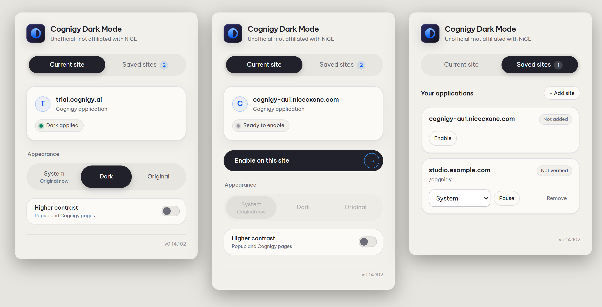

# Cognigy Graphite

A dark theme for Cognigy.AI, as a Chrome extension. Only colours change; layout, controls and images stay the same.

[](https://github.com/zaczzk/cognigy_dark_mode/actions/workflows/ci.yml)
[](https://github.com/zaczzk/cognigy_dark_mode/releases)
[](LICENSE)

Preview release. Needs Chrome 120 or newer.

## Install

1. Download the `.zip` from the [latest release](https://github.com/zaczzk/cognigy_dark_mode/releases/latest) (not `receipt.json`).
2. Unzip it to a folder you'll keep.
3. In Chrome, open `chrome://extensions`, turn on **Developer mode**, click **Load unpacked**, and pick the folder that contains `manifest.json`.
4. Pin the Graphite icon to your toolbar.

**To update:** unzip the new release over the same folder, click **Reload** on `chrome://extensions`, then refresh your Cognigy tabs. (Cloned the repo instead? Run `git pull`.)

## Use it

`trial.cognigy.ai` works straight away. For any other Cognigy site, including NiCE-hosted ones like `cognigy-au1.nicecxone.com`:

1. Open the site in a tab and click the Graphite icon.
2. Click **Enable on this site** and approve access. Chrome asks once for all `cognigy-<region>.nicecxone.com` sites; later ones need no prompt.

It starts in **System** mode, so Cognigy follows your computer's light or dark setting. To change that:

| Mode | Result |
|---|---|
| **System** (default) | Matches your computer's light or dark setting. |
| **Dark** | Always dark. |
| **Original** | Cognigy's normal colours. |

**Higher contrast** makes text, icons and borders stand out more. Pause or remove saved sites under **Your applications**.



## What it covers

Flows, AI Agents, Knowledge, Simulator, Trainer, settings, Admin Center, Insights and the project list. Only `/projects`, `/project/…`, `/admincenter` and `/insights` pages are recoloured. Anything not yet themed keeps Cognigy's normal colours.

Still a preview. See the [known gaps](docs/COVERAGE.md).

## Troubleshooting

| You see… | Do this |
|---|---|
| No toolbar icon | Click the puzzle-piece menu and pin **Cognigy Graphite**. |
| **Reload this page to connect** | Reload the Cognigy tab. |
| Light page in **System** mode | Your computer is set to light. Choose **Dark**. |
| **Dark · some areas kept original** | Normal. A few parts aren't themed yet. |
| Something is still white in **Dark** | [Report it](https://github.com/zaczzk/cognigy_dark_mode/issues) with the version and steps. Leave out private data. |
| Can't turn on Developer mode | Your organisation's Chrome policy blocks it. Ask your IT team. |

## Privacy

- No network requests, analytics or remote code.
- Saves only your site list and appearance choices, on your computer.
- Never stores page content or what you type.
- Permissions: `storage`, `activeTab`, `scripting` and `trial.cognigy.ai`. Other sites are granted only when you enable them.

## Contribute

Needs Node 22+, Chrome, and Python 3.10+ for packaging. No install step.

```bash
node --test "tests/*.test.cjs"
node tests/browser/build.cjs
node tests/browser/run-headless.cjs
```

To run from source, load the repo's `extension/` folder as above. CI tests every PR and `main`. Tagged releases publish a zip with SHA-256 checksums.

**Rules:** change colours only, keep Original identical to stock Cognigy, no image filters, no new permissions or network calls.

[Contributor guide](CONTRIBUTING.md) · [Architecture](docs/ARCHITECTURE.md) · [Agent instructions](AGENTS.md)

## License

[MIT](LICENSE). Uses the [Be Vietnam Pro](extension/fonts/OFL.txt) font (OFL). Unofficial community project, not affiliated with NiCE Cognigy. "Cognigy" is its owner's trademark.
