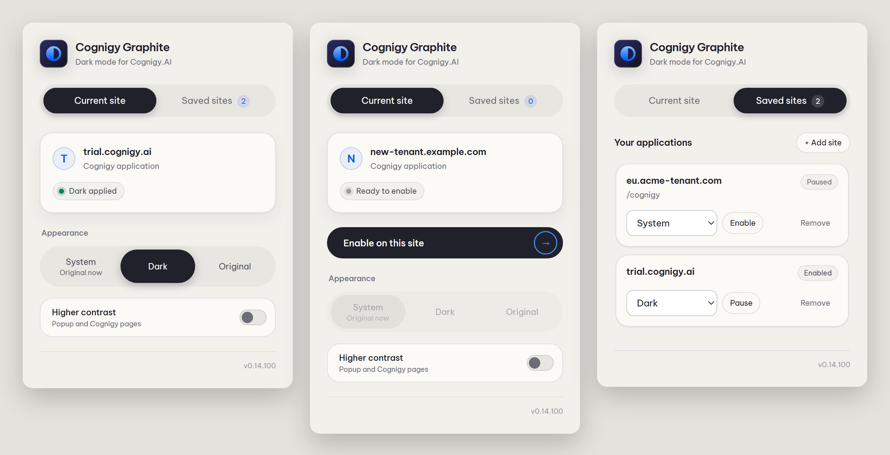
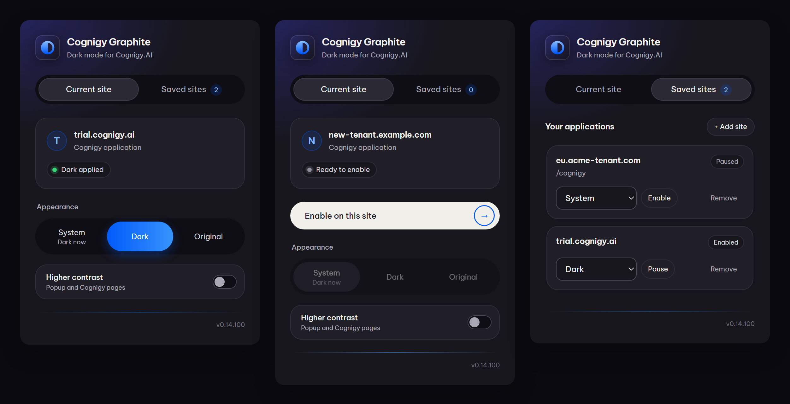

# Cognigy Graphite

**Dark mode for Cognigy.AI.** Colours change. Your layout, controls and media stay familiar.

**Preview · 0.14.100 · Chrome 120+**

[Install](#install) · [Use it](#use-it) · [Troubleshooting](#troubleshooting) · [Contribute](#contribute)

## Install

1. Download this repository: **Code → Download ZIP**. Unzip it.
2. Open `chrome://extensions` in Chrome.
3. Turn on **Developer mode**.
4. Click **Load unpacked**. Select the repository's **`extension/`** folder.
5. Open Cognigy. Click the Graphite toolbar icon.

**Already cloned it?** Load the same `extension/` folder.

## Use it

The toolbar popup follows your system theme: **Ink** in dark mode, **Paper** in light mode.

<picture>
  <source media="(prefers-color-scheme: dark)" srcset="docs/images/popup-ink.png">
  
</picture>

<details><summary>Both themes</summary>

**Ink (dark)**



**Paper (light)**


</details>

| Mode | Result |
|---|---|
| **System** | Follows your system's light/dark preference. |
| **Dark** | Keeps Cognigy dark. |
| **Original** | Restores Cognigy's native colours. |

**Higher contrast:** a switch in the popup strengthens text, icons, borders and focus rings, in the popup and on every enabled Cognigy site. Surfaces keep the same graphite palette.

**Trial:** `trial.cognigy.ai` is enabled by default.

**Another Cognigy host:** open the popup → **Enable on this site** → approve access to that hostname.

**Saved sites:** add, pause, enable or remove hosts. An optional path prefix supports apps hosted under a subpath.

## What it covers

- **Authoring:** flows, inspector, AI Agents, Knowledge, settings, Simulator, Trainer and resource lists.
- **Admin Center** and **Insights**.
- **Project index** and dashboard.

Recognised components receive the graphite palette. Unsupported or unexpected components keep their native colours.

**Still a preview.** See [checked screens and known gaps](docs/COVERAGE.md) or the [latest verification record](docs/STATUS-2026-10-29.md).

## Update

1. Pull or download the latest source.
2. Open `chrome://extensions` → **Reload** Graphite.
3. **Reload every open Cognigy tab.**

Keep using the same extension folder to preserve its identity and settings.

## Troubleshooting

| You see… | Do this |
|---|---|
| **Reload this page to connect** | Reload the Cognigy tab. |
| A light page in **System** mode | Check your system preference. Choose **Dark** for an always-dark theme. |
| A white component in **Dark** mode | It may be unsupported. [Report the screen and interaction](https://github.com/zaczzk/cognigy_dark_mode/issues). |
| **Partly supported** | This label alone does not mean a component failed or remains white. |

Include the extension version and steps to reproduce. Keep account details and captures private.

## Privacy

- No network requests, analytics or remote code.
- Saves approved hostnames, optional path prefixes and appearance choices locally.
- Never stores page content, input values or record IDs.
- Required permissions: `storage`, `activeTab`, `scripting`, plus `trial.cognigy.ai`. Other hosts are granted individually.

## Contribute

**Node 22+ and Chrome.** No npm install or bundler.

```bash
node --test "tests/*.test.cjs"
node tests/browser/build.cjs
node tests/browser/run-headless.cjs
```

CI checks PRs and pushes to `main`.

**Rules:** colours only, exact Original restoration, no media filters, no new permissions or network calls. Private captures stay local.

[Contributor guide](CONTRIBUTING.md) · [Architecture](docs/ARCHITECTURE.md) · [Agent instructions](AGENTS.md)

## License & affiliation

[MIT](LICENSE). The popup bundles [Be Vietnam Pro](extension/fonts/OFL.txt) under the SIL Open Font License 1.1. Unofficial community project, unaffiliated with NiCE Cognigy. "Cognigy" is its owner's trademark and describes compatibility.
